# FeatureFlagApi

A simulated payment API demonstrating feature flags and related routing controls.
See the [project index](../README.md) for other projects in the solution.

## Contents

- [Quick start](#quick-start)
- [Demo and endpoint reference](#demo-and-endpoint-reference)
- [Payment request format](#payment-request-format)
- [Feature flag demonstrations](#feature-flag-demonstrations)
- [Routing controls](#routing-controls)
- [Combined filter demonstrations](#combined-filter-demonstrations)
- [Troubleshooting and repeatable runs](#troubleshooting-and-repeatable-runs)

## Quick start

### Prerequisites

| Requirement | Used for |
| --- | --- |
| .NET 11 SDK | Restoring and running the API |

### Start the API

Requires the .NET 11 SDK. From the solution root:

```powershell
dotnet restore NetFeat.sln
dotnet run --project FeatureFlagApi --launch-profile http
```

The `http` launch profile sets Development and listens at `http://localhost:5159`.

### Run the integration tests

From the solution root, run:

```powershell
dotnet test FeatureFlagApi.IntegrationTests
```

To see output from passing tests, enable the detailed console logger:

```powershell
dotnet test FeatureFlagApi.IntegrationTests --logger "console;verbosity=detailed"
```

The output includes payment provider selections, refund responses, batch routing
counts, and experiment success rates. Batch tests report summaries. The TPS output
also shows in-process batch timing and the provider returned at each recovery check.

In Rider's **Unit Tests** window, each demonstration has its own test class.
Run that class, then select an individual case in the test session to see its
report in the **Output** pane. For example, select the case under
`ConcurrentTpsBurstTests` to see the routing split and recovery:

```text
Scenario   Concurrent TPS burst with 100 requests
Expected   20 new, 80 legacy; legacy at 999 ms, new at 1,000 ms on the limiter clock.
Actual     100 successful previews, 20 new, 80 legacy.
Details    In-process batch duration: 74.0 ms.
Actual     At 999 ms on the limiter clock: legacy (tps-limit-reached).
Actual     At 1,000 ms on the limiter clock: new (capacity-available).
```

The `Expected` lines describe what the test checks. The `Details` lines show
observations or configuration targets such as the 50% rollout.

The xUnit tests use ASP.NET Core's `WebApplicationFactory` to start a fresh
in-process API host for each case. Configuration overrides apply only to that host.

### Configuration

| File | Settings |
| --- | --- |
| [appsettings.Development.json](appsettings.Development.json) | Flags under `feature_management.feature_flags`; refund failure injection under `RefundDemo` |
| [appsettings.json](appsettings.json) | New-provider capacity under `TpsRouting.NewProviderLimitPerSecond` |
| [launchSettings.json](Properties/launchSettings.json) | Local URLs and the Development environment |

Feature definitions are in [appsettings.Development.json](appsettings.Development.json)
under `feature_management.feature_flags`. The TPS limit is in
[appsettings.json](appsettings.json). After changing demo configuration, restart
the API for a repeatable run. Restarting also resets in-memory limiter and refund
state. Integration tests use the sample configuration with in-memory overrides where needed.

## Demo and endpoint reference

All endpoints below use **POST**. Paths are relative to `http://localhost:5159`.

| Demonstration | Endpoint | Control | Integration tests |
| --- | --- | --- | --- |
| [Global release](#global-release-flag) | `/payments` | `NewPaymentProvider` | [GlobalReleaseFlagTests](../FeatureFlagApi.IntegrationTests/GlobalReleaseFlagTests.cs) |
| [Customer release](#customer-specific-release) | `/payments/customer-release` | `CustomerSpecificPaymentRelease` | [CustomerSpecificReleaseTests](../FeatureFlagApi.IntegrationTests/CustomerSpecificReleaseTests.cs) |
| [Percentage Rollout](#percentage-rollout) | `/payments/routing-preview` | `NewPaymentProviderRouting` | [PercentageRolloutTests](../FeatureFlagApi.IntegrationTests/PercentageRolloutTests.cs) |
| [Refund Kill Switch](#refund-kill-switch) | `/payments/{paymentId:guid}/refund` | `RefundsEnabled` and in-memory latch | [RefundKillSwitchTests](../FeatureFlagApi.IntegrationTests/RefundKillSwitchTests.cs) |
| [Retry experiment](#payment-retry-experiment) | `/payments/experiment-preview` | `PaymentRetryExperiment` | [PaymentRetryExperimentTests](../FeatureFlagApi.IntegrationTests/PaymentRetryExperimentTests.cs) |
| [Scheduled release](#scheduled-provider-release) | `/payments/time-window-release` | `ScheduledPaymentProviderRelease` | [ScheduledProviderReleaseTests](../FeatureFlagApi.IntegrationTests/ScheduledProviderReleaseTests.cs) |
| [Batch quota](#quota-based-routing) | `/payments/quota-routing-preview` | Request quota | [QuotaRoutingTests](../FeatureFlagApi.IntegrationTests/QuotaRoutingTests.cs) |
| [TPS routing](#tps-based-routing) | `/payments/tps-routing-preview` | Process-local capacity | [TpsRoutingTests](../FeatureFlagApi.IntegrationTests/TpsRoutingTests.cs) |
| [Concurrent TPS Burst](#concurrent-tps-burst) | `/payments/tps-routing-preview` | Same TPS limiter | [ConcurrentTpsBurstTests](../FeatureFlagApi.IntegrationTests/ConcurrentTpsBurstTests.cs) |
| [Combined AND filters](#combined-filters-and) | `/payments/combined-filter-release` | `CombinedPaymentProviderRelease` | [CombinedAndFiltersTests](../FeatureFlagApi.IntegrationTests/CombinedAndFiltersTests.cs) |
| [Combined OR filters](#combined-filters-or) | `/payments/any-filter-release` | `AnyFilterPaymentProviderRelease` | [CombinedOrFiltersTests](../FeatureFlagApi.IntegrationTests/CombinedOrFiltersTests.cs) |

## Payment request format

The global, customer-specific, scheduled, AND-filter, and OR-filter release
endpoints accept this shared JSON body and return `paymentId`, `status`, and
`provider` for valid payments:

```json
{
  "orderId": "order-101",
  "amount": 2599,
  "currency": "USD",
  "paymentMethodToken": "pm_demo_success"
}
```

| Field or header | Requirement |
| --- | --- |
| `orderId` | Nonblank order ID |
| `amount` | Positive amount |
| `currency` | `USD` |
| `paymentMethodToken` | `pm_demo_success` or `pm_demo_decline` |
| `X-Demo-Customer-Id` | Required for customer-specific, AND-filter, and OR-filter releases; trimmed before evaluation |

Invalid input returns **400**. `pm_demo_success` produces `succeeded`, while
`pm_demo_decline` produces `declined`. Valid declined payments still return **200**.
Preview and refund endpoints use the inputs described in their own sections.

## Feature flag demonstrations

### Global release flag

**Purpose:** switch all payments between the legacy and new implementations.

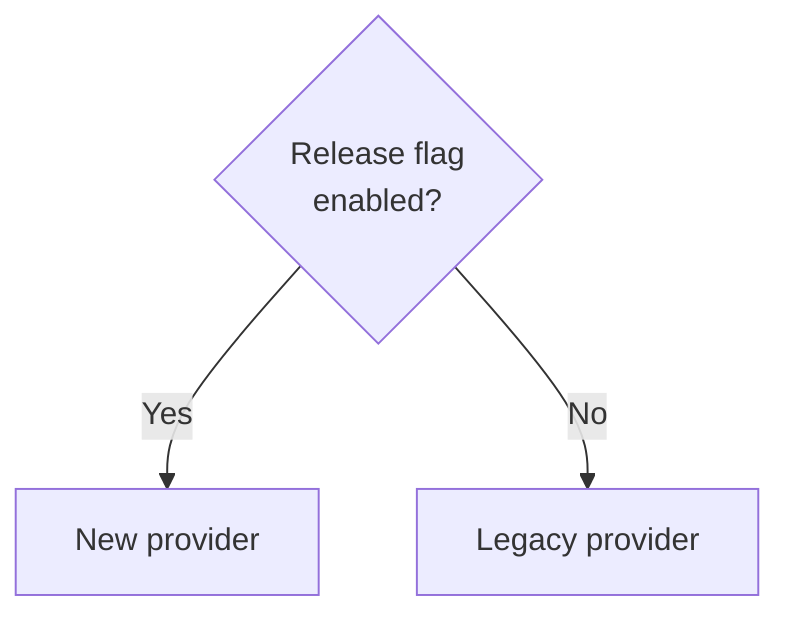

**Implementation:** [PaymentEndpoints](Endpoints/PaymentEndpoints.cs) evaluates
`NewPaymentProvider` and calls the selected provider's `Charge` method.
`POST /payments` returns `paymentId`, `status`, and `provider`.

**Configuration:** `NewPaymentProvider.enabled` defaults to `false` (legacy).
Set it to `true` to select new for every request to this endpoint.

Global release tests verify both flag settings.

### Customer-specific release

**Purpose:** release the new provider only to an explicit customer allowlist.

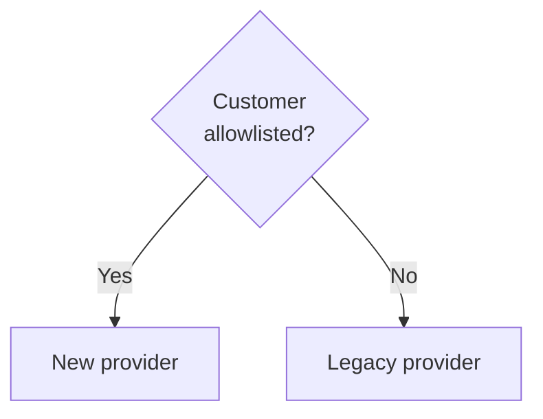

With the sample flag enabled, the allowlist determines the provider.

**Implementation:** [CustomerSpecificReleaseEndpoints](Endpoints/CustomerSpecificReleaseEndpoints.cs)
handles `POST /payments/customer-release`. It trims the required
`X-Demo-Customer-Id` header and passes it as `TargetingContext.UserId` when evaluating
`CustomerSpecificPaymentRelease`. The selected provider processes the simulated
payment. Missing or blank customer identity returns 400.

**Configuration:** `Microsoft.Targeting` has `Audience.Users: ["customer-001"]`,
empty groups, and `DefaultRolloutPercentage: 0`. Edit Users to change the allowlist.
Disabling or omitting the flag selects legacy for everyone.

Customer release tests verify both allowlist outcomes and missing identity.

### Percentage rollout

**Purpose:** assign a stable proportion of customers to the new provider.

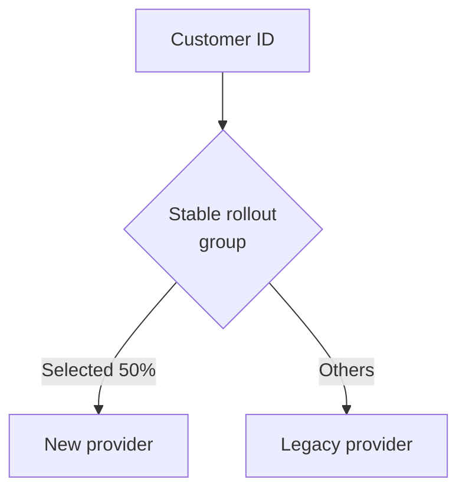

With the flag enabled, the same customer stays in the same group while configuration is unchanged. The 50% target does not guarantee an exact batch count.

**Implementation:** [PaymentRoutingEndpoints](Endpoints/PaymentRoutingEndpoints.cs)
evaluates `NewPaymentProviderRouting` using the customer header as targeting
context. `POST /payments/routing-preview` returns the customer and provider;
it does not charge a payment. A missing or blank header returns 400.

**Configuration:** `Microsoft.Targeting` currently uses
`Audience.DefaultRolloutPercentage: 50`.

The rollout test previews 100 customers twice and checks that assignments stay stable.

### Refund kill switch

**Purpose:** pause refunds through a manual flag or a simulated provider failure.

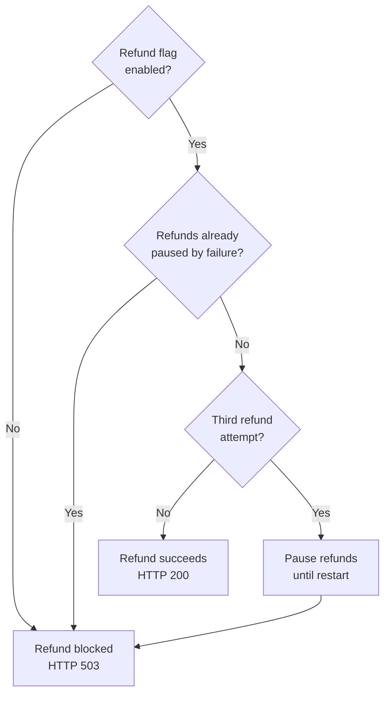

With the sample configuration and a fresh API process, requests return
**200 → 200 → 503 → 503 → 503**. The third attempt triggers the pause;
later requests stay blocked. Restart the API to clear the pause and reset the
attempt count. `RefundsEnabled` must also be true for refunds to resume.

**Implementation:** [RefundEndpoints](Endpoints/RefundEndpoints.cs) checks
`RefundsEnabled` before using the singleton [RefundKillSwitch](Providers/RefundKillSwitch.cs).
`POST /payments/{paymentId:guid}/refund` returns a simulated successful refund or
503 when refunds are disabled. The demo's third admitted refund attempt throws a
caught exception, trips the in-memory `_tripped` latch, and returns 503. Later
attempts are blocked with 503.

**Configuration:** `RefundsEnabled.enabled: true` permits refunds unless the latch
is tripped. `RefundDemo.FailOnRequest: 3` enables the third-attempt failure in
Development; zero disables failure injection. The latch does not modify the flag
or configuration file. Changing the manual flag back to true cannot clear a
tripped latch; restart the API to reset it.

The refund tests verify the five-request failure sequence and check that a disabled flag blocks the first refund.

### Payment retry experiment

**Purpose:** compare final payment success with and without a retry.

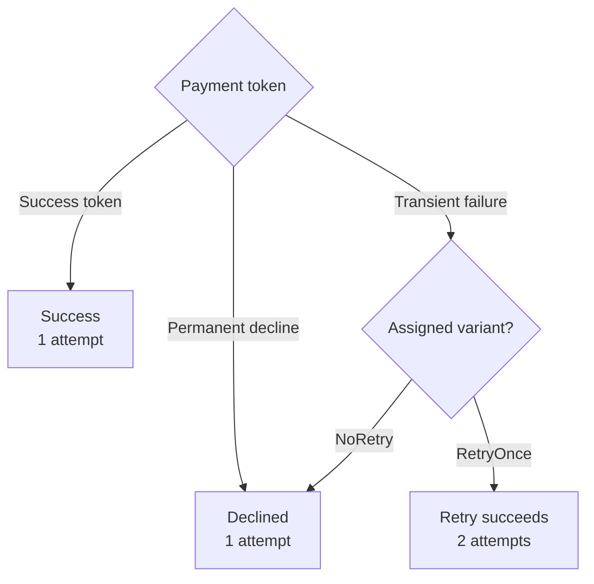

**Implementation:** [ExperimentEndpoints](Endpoints/ExperimentEndpoints.cs) handles
`POST /payments/experiment-preview`, accepts customer ID and demo token, and
resolves a named variant through `GetVariantAsync` with customer targeting context.
It returns experiment name, customer, variant, attempts, and final status. Blank
identity or unsupported tokens return 400.

**Configuration:** `PaymentRetryExperiment` allocates percentiles 0–50 to
`NoRetry` and 50–100 to `RetryOnce`, with seed `payment-retry-v1`. Both default
variants are `NoRetry`; disabling the flag assigns control to everyone.
Missing/unknown variants fall back to `NoRetry` with a warning. Assignment is stable
with unchanged identity, seed, and allocation; counts need not be exactly 50/50.

| Token | NoRetry | RetryOnce |
|---|---|---|
| `pm_demo_success` | Success, 1 attempt | Success, 1 attempt |
| `pm_demo_transient_failure` | Decline, 1 attempt | Success, 2 attempts |
| `pm_demo_decline` | Decline, 1 attempt | Decline, 1 attempt |

The experiment test previews 100 customers and checks all three tokens for both variants.

### Scheduled provider release

**Purpose:** enable the new provider only during a one-time UTC window.

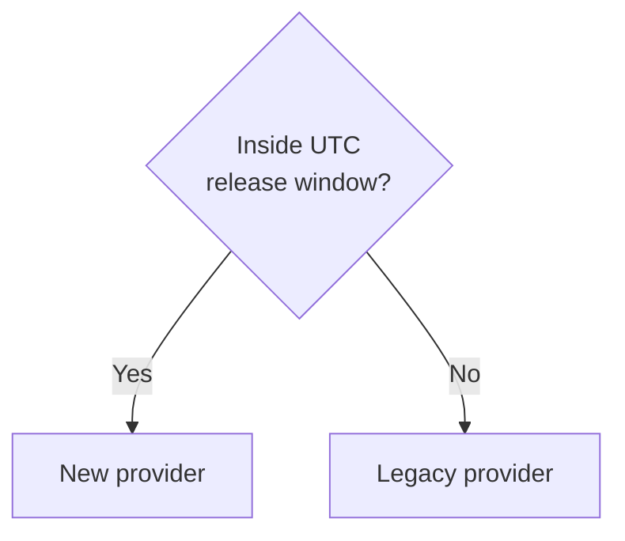

With the flag enabled, start is inclusive and end is exclusive.

**Implementation:** [TimeWindowReleaseEndpoints](Endpoints/TimeWindowReleaseEndpoints.cs)
evaluates `ScheduledPaymentProviderRelease` on `POST /payments/time-window-release`
and calls the corresponding simulated provider. It uses the shared payment payload
and validation described above.

**Configuration:** `Microsoft.TimeWindow` has Start `2030-01-01T12:00:00Z` and End
`2030-01-01T13:00:00Z`. Start is inclusive and End exclusive. The API server's clock
controls evaluation. Before/after the window, or with a disabled/missing flag,
legacy is selected. The initial window therefore selects legacy until its start.

The scheduled release tests cover upcoming, active, and expired windows, a disabled flag, and invalid payment input.

## Routing controls

These custom controls operate independently of feature flags and return routing
previews without charging payments.

| Control | Assignment rule | Scope | What to expect |
| --- | --- | --- | --- |
| Percentage targeting (above) | Stable customer assignment | Customer identity and unchanged flag configuration | Approximately the configured percentage across a population |
| Batch quota | First IDs receive new-provider slots | One submitted batch | Exact quota; input order matters |
| TPS limiter | Admit to new while capacity is available | One API process, across all customers | Overflow immediately selects legacy |

### Quota-based routing

**Purpose:** guarantee an exact count within a submitted batch.

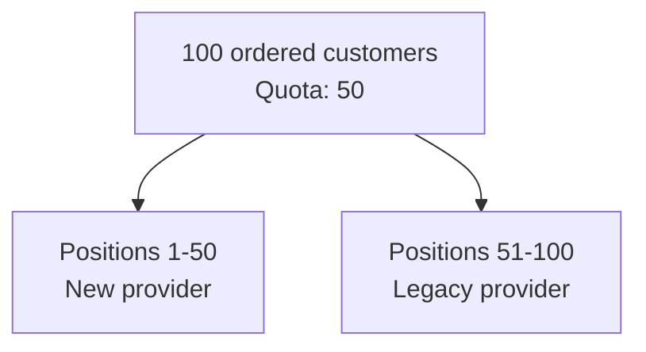

Example allocation: the submitted order determines who gets each slot. Every batch starts a fresh allocation.

**Implementation:** [QuotaRoutingEndpoints](Endpoints/QuotaRoutingEndpoints.cs)
handles `POST /payments/quota-routing-preview`. It assigns the first
`newProviderQuota` IDs to new and the remainder to legacy, returning assignments
and totals. This is an ordered preview, not a feature flag or persistent routing
assignment. Changing input order can change which customer receives a slot.

**Configuration:** supply `customerIds` and `newProviderQuota` in the request body.
Accepts 1–1000 nonblank IDs, unique after trimming, and a quota from zero through
the batch size. Invalid batches return 400. No flag configuration is involved.

The quota test checks that the first 50 of 100 customers use the new provider and the remaining 50 use legacy.

### TPS-based routing

**Purpose:** protect new-provider capacity and immediately route overflow to legacy.

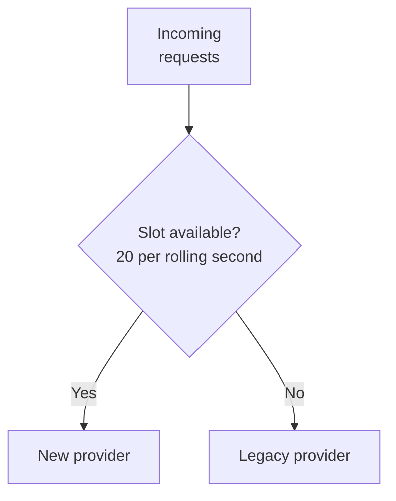

The sample limit is 20 per rolling second. Slots recover as earlier admissions expire.

**Implementation:** [TpsRoutingEndpoints](Endpoints/TpsRoutingEndpoints.cs) handles
`POST /payments/tps-routing-preview` with a required customer header. A singleton
[TpsRoutingLimiter](Providers/TpsRoutingLimiter.cs) tracks admissions in the preceding
second under a lock. Available capacity selects new with `capacity-available`;
exhausted capacity selects legacy with `tps-limit-reached`. No waiting queue or
payment charge is involved. Missing identity returns 400.

**Configuration:** `TpsRouting.NewProviderLimitPerSecond: 20` in appsettings.json.
The limit must be positive and applies per API process, shared across all customers
calling this endpoint. It is independent of feature flags and not shared across
replicas. Restart after changing the limit.

The sequential TPS test sends 100 previews with a controlled clock and verifies overflow and slot recovery.

### Concurrent TPS burst

**Purpose:** demonstrate the same TPS limiter under a short concurrent burst.

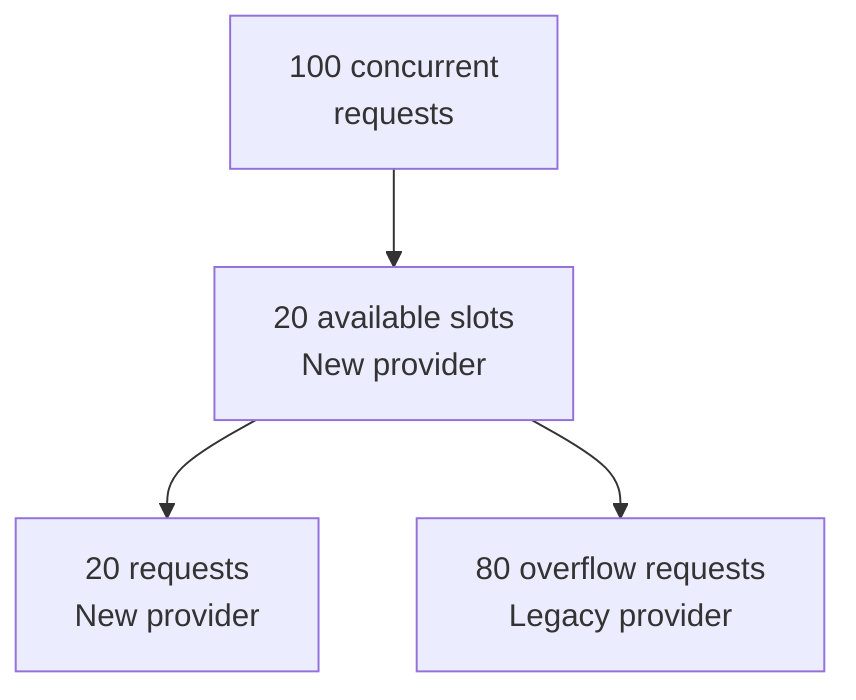

Example outcome with an idle limiter, limit 20, and all 100 successful requests completed within one second. A slower burst can admit more requests to new.

The concurrent TPS test uses `Task.WhenAll` to send 100 requests. It holds the limiter clock fixed to verify a 20/80 split, then advances the clock to check capacity recovery at one second.

## Combined filter demonstrations

Both examples use the same three filters with different requirement types:

| Filter | Sample configuration | Evaluation behavior |
| --- | --- | --- |
| `Microsoft.Targeting` | `customer-001`; no groups; default rollout 0% | Only the allowlisted customer passes |
| `Microsoft.TimeWindow` | Daily 04:00-06:00 UTC, anchored on January 1, 2026; interval 1; `NoEnd` | Uses the API server clock; start inclusive, end exclusive |
| `Microsoft.Percentage` | `Value: 20` | Random sampling on each evaluation; assignment can change between requests |

### Combined filters (AND)

**Purpose:** release the new provider only to customer-001, during 04:00–06:00 UTC
 every day, with a 20% chance on each eligible evaluation.

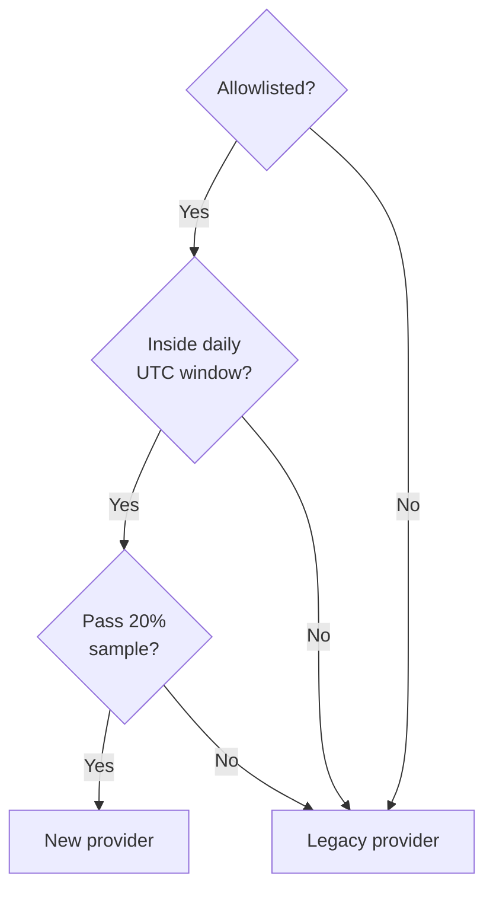

With the flag enabled, all three checks must pass. The first failed check selects legacy.

**Implementation:** [CombinedFilterReleaseEndpoints](Endpoints/CombinedFilterReleaseEndpoints.cs)
handles POST /payments/combined-filter-release using the shared payment body and
required X-Demo-Customer-Id header. It trims identity, evaluates the flag once per
request with targeting context through the normal variant feature manager, and
calls the selected simulated provider. Invalid identity or payment input returns 400.

**Configuration:** CombinedPaymentProviderRelease uses requirement_type: All.
Microsoft.Targeting restricts Audience.Users to customer-001, with no groups and
zero default rollout. Microsoft.TimeWindow repeats daily with Interval 1 and NoEnd,
anchored at 2026-01-01 04:00–06:00 UTC. Start is inclusive and end exclusive.
Microsoft.Percentage has Value 20. Filters run in targeting/time/percentage order;
an early rejection short-circuits. Disabled or missing flags select legacy.

The date anchors recurrence, not a one-day restriction. The API server clock is
used. All three conditions must pass; the default Any requirement would permit
unintended access. The same customer can receive different providers on successive
requests: PercentageFilter samples evaluations, unlike stable percentage targeting.

The AND filter tests check each condition and exercise 100 payments with the 20% sampling configuration.

### Combined filters (OR)

**Purpose:** enable the new provider when any one of targeting, daily scheduling,
or random sampling permits it. This complements the existing AND demonstration.

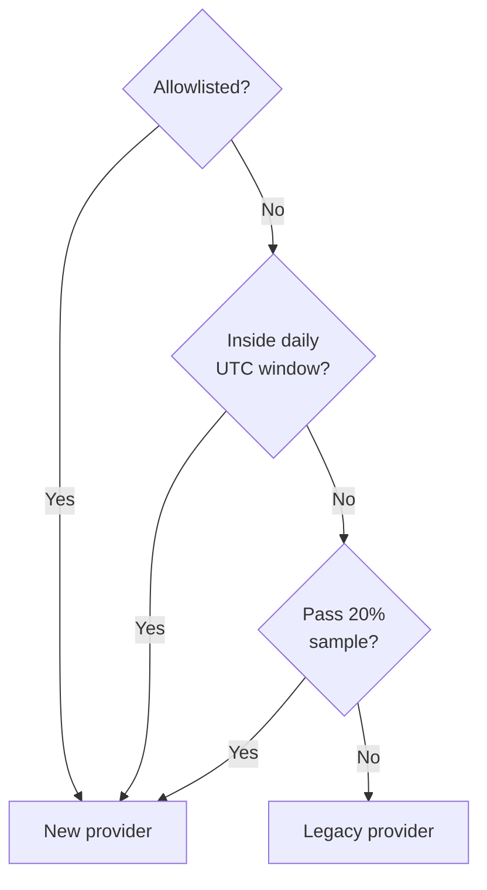

With the flag enabled, the first passing check selects new. Legacy is selected only when all three fail.

**Implementation:** [AnyFilterReleaseEndpoints](Endpoints/AnyFilterReleaseEndpoints.cs)
handles POST /payments/any-filter-release with the existing payment body and
required X-Demo-Customer-Id header. It trims identity and evaluates the flag once
per request with targeting context through the normal variant feature manager.
It calls the selected simulated provider and returns the existing payment response.
Invalid payment or missing/blank customer identity returns 400.

**Configuration:** AnyFilterPaymentProviderRelease uses requirement_type: Any.
Filters run in targeting/time/percentage order, stopping at the first passing
filter. Audience.Users contains customer-001, groups are empty, and default
rollout is zero. The window recurs daily, interval 1, NoEnd, anchored at
2026-01-01T04:00:00Z through 2026-01-01T06:00:00Z. Start is inclusive and end
exclusive; scheduling uses the API server's UTC clock. Percentage Value is 20.
The same customer may receive different providers on repeated random evaluations.
A disabled or missing flag selects legacy for everyone.

| Customer and time (flag enabled) | AND example | OR example |
|---|---|---|
| Allowlisted, inside window | Approximately 20% new | Always new |
| Allowlisted, outside window | Always legacy | Always new |
| Unlisted, inside window | Always legacy | Always new |
| Unlisted, outside window | Always legacy | Approximately 20% new |

The OR filter tests check each passing condition and exercise 100 payments for an unlisted customer outside the window with the 20% sampling configuration.

## Troubleshooting and repeatable runs

| Symptom or task | Action or explanation |
| --- | --- |
| Repeating a demo after configuration changes | Restart the API; sample assertions assume the documented configuration |
| Refunds keep returning 503 | Check `RefundsEnabled`; restart to clear a tripped latch. Enabling the flag alone does not reset it |
| Unexpected refund failure count | Earlier admitted calls consume attempts. Run the batch from a fresh process |
| Scheduled release stays on legacy | The sample window is in 2030. Update the UTC window and restart the API |
| AND-filter sample stays on legacy | All filters must pass, including the daily UTC window; random sampling still applies inside it |
| Observed rollout differs from 50% or 20% | Population targets and random sampling do not guarantee exact batch counts; use quota routing for an exact count |
| Sequential TPS demo assigns more than 20 requests to new | Capacity recovers as requests extend beyond one second; use the concurrent burst to observe overflow |

All results are simulated. State is held in memory, and the TPS limit is local to
each process rather than shared across replicas. Experiment summaries and burst
measurements do not establish real payment performance or sustained capacity.
