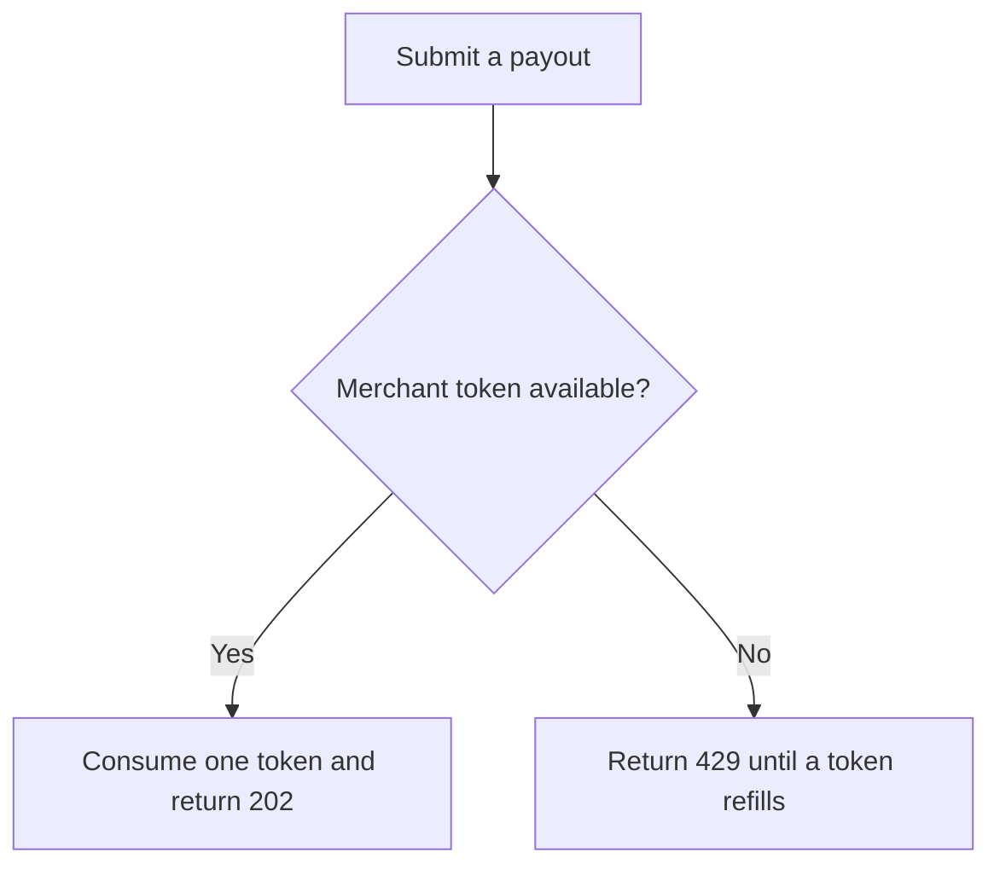
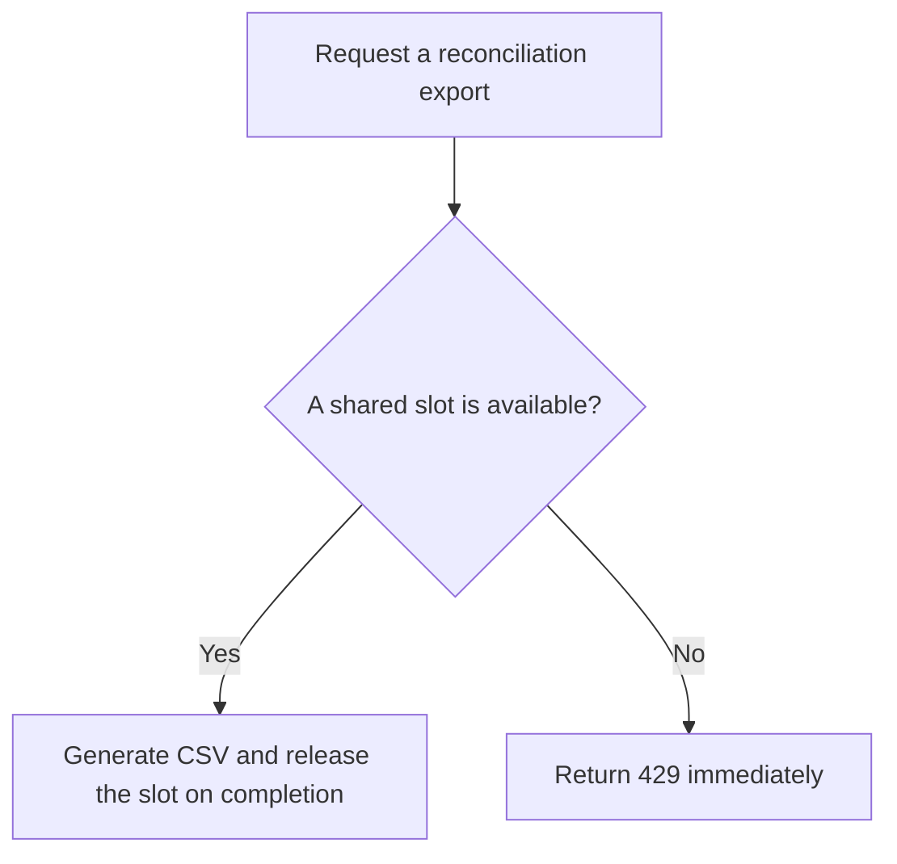

# RateLimitApi

A simulated merchant payout API demonstrating the four ASP.NET Core rate limiter types.
See the [project index](../README.md) for other projects in the solution.

## Contents

- [Quick start](#quick-start)
- [Demo and endpoint reference](#demo-and-endpoint-reference)
- [Payout request format](#payout-request-format)
- [Rate limiter demonstrations](#rate-limiter-demonstrations)
- [Request volume controls](#request-volume-controls)
- [Fixed and sliding window comparison](#fixed-and-sliding-window-comparison)
- [Troubleshooting and repeatable runs](#troubleshooting-and-repeatable-runs)

## Quick start

### Prerequisites

| Requirement | Used for |
| --- | --- |
| .NET 11 SDK | Restoring, running, and testing the API |

### Start the API

Run these commands from the solution root.

```powershell
dotnet restore NetFeat.sln
dotnet run --project RateLimitApi --launch-profile http
```

The `http` launch profile sets Development and listens at `http://localhost:5295`.
Open [RateLimitApi.http](RateLimitApi.http), submit a payout, and copy the returned
`payoutId` into `@payoutId` before running the status request.

### Run the integration tests

Run the rate-limiting tests from the solution root.

```powershell
dotnet test RateLimitApi.IntegrationTests
```

Use the detailed console logger to see output from passing tests.

```powershell
dotnet test RateLimitApi.IntegrationTests --logger "console;verbosity=detailed"
```

In Rider's **Unit Tests** window, run a limiter class and select a case to see
its report in the **Output** pane. For example, the burst case under
`TokenBucketTests` reports admission, throttling, and recovery.

```text
Expected   Five accepted payouts, then HTTP 429 for Merchant A, with Merchant B and status polling available.
Actual     HTTP 429, Retry-After=2.
Actual     Recovered with HTTP 202.
```

The xUnit tests use ASP.NET Core's `WebApplicationFactory` to start a fresh
in-process API host for each case. Configuration overrides apply only to that host.
Run `dotnet test NetFeat.sln` to verify both integration suites.

### Configuration

| File | Settings |
| --- | --- |
| [appsettings.json](appsettings.json) | Limiter settings under `RateLimiting`, including the status policy and permit counts |
| [launchSettings.json](Properties/launchSettings.json) | Local URLs and the Development environment |

Restart the API after changing the configuration. Restarting also clears payouts
and resets limiter state.

## Demo and endpoint reference

Paths are relative to `http://localhost:5295`.

| Demonstration | Endpoint | Control | Integration tests |
| --- | --- | --- | --- |
| [Token bucket](#token-bucket) | `POST /payouts` | Five tokens per merchant, with one token added every two seconds | [TokenBucketTests](../RateLimitApi.IntegrationTests/TokenBucketTests.cs) |
| [Fixed window](#fixed-window) | `GET /payouts/{id}` | Ten requests per merchant per ten-second window | [FixedWindowTests](../RateLimitApi.IntegrationTests/FixedWindowTests.cs) |
| [Sliding window](#sliding-window) | `GET /payouts/{id}` | Ten requests per merchant across five two-second segments | [SlidingWindowTests](../RateLimitApi.IntegrationTests/SlidingWindowTests.cs) |
| [Concurrency](#concurrency) | `GET /reconciliation/export` | Two in-flight exports shared across merchants | [ConcurrencyLimiterTests](../RateLimitApi.IntegrationTests/ConcurrencyLimiterTests.cs) |

## Payout request format

Send this JSON body to `POST /payouts` with `Content-Type: application/json`.

```json
{
  "amountInCents": 2599,
  "currency": "USD"
}
```

| Field or header | Requirement |
| --- | --- |
| `amountInCents` | Positive integer amount in cents |
| `currency` | `USD` |
| `X-Demo-Merchant-Id` | Required on all three demo endpoints. Use `merchant-a` or `merchant-b`. |

A valid submission returns **202 Accepted** with `payoutId`, `amountInCents`,
`currency`, `status: pending`, and a `Location` header. Follow that header with
the same merchant ID to get **200 OK**. A missing payout or one owned by another
merchant returns **404**. The export endpoint returns **200 OK** with a
`reconciliation.csv` attachment containing that merchant's payouts.
Invalid payout input or a missing or unknown merchant header returns **400**
when the request reaches validation.

## Rate limiter demonstrations

### Token bucket

**Purpose** Let a merchant submit a short batch of payouts and refill its capacity gradually.



**Implementation** [MerchantRateLimiting](RateLimiting/MerchantRateLimiting.cs)
partitions the submission policy by merchant. An empty bucket leaves the other
merchant's bucket and the status-polling budget available.

**Configuration** `SubmissionTokenLimit` is 5, `SubmissionTokensPerPeriod` is 1,
and `SubmissionReplenishmentPeriod` is two seconds. Six submissions within a
refill interval return five **202** responses followed by **429**.

The token bucket tests verify the burst, merchant and endpoint isolation, and recovery.

### Fixed window

**Purpose** Give each merchant a predictable budget for checking payout status.

**Implementation** The status policy uses one budget per merchant across all
payout IDs. At the end of each fixed window, the full allowance returns.

**Configuration** `StatusPolicy` defaults to `FixedWindow`. `StatusPermitLimit`
is 10 and `StatusWindowLength` is ten seconds.

The fixed window test polls two payouts, exhausts their shared quota, and checks
that the full budget is available in the next window.

### Sliding window

**Purpose** Restore polling capacity in segments as older requests expire.

**Implementation** The same status route tracks admissions in time segments.
When a segment expires, its used permits become available again.

**Configuration** Set `StatusPolicy` to `SlidingWindow`. With ten seconds and
`StatusSegmentsPerWindow` set to 5, each segment spans two seconds.

The sliding window test submits two batches in separate segments and verifies
that the first expired segment restores only the permits used by that batch.

### Concurrency

**Purpose** Protect report generation capacity while exports are running.



**Implementation** [PayoutEndpoints](Endpoints/PayoutEndpoints.cs) holds the
slot during a cancellable two-second delay and CSV generation. A third request
gets **429** while both slots are in use.

**Configuration** `ExportPermitLimit` is 2, shared across merchants in one API process.

The concurrency test holds two exports open with a gate, verifies immediate
rejection, then releases an export and confirms that another can start.

## Request volume controls

| Policy scope | Shared capacity | When capacity returns |
| --- | --- | --- |
| Payout submission | One token bucket per merchant | One token at each refill |
| Payout status | One window budget per merchant across payout IDs | At the window reset or as sliding segments expire |
| Reconciliation export | One pool of in-flight slots per API process | As active exports finish |

All policies use a queue limit of zero. Rejected requests return **429 Too Many
Requests** with a Problem Details body. Time-based policies include
`Retry-After` when ASP.NET Core supplies an estimate. The concurrency policy
omits it because the next slot depends on when an active export finishes.
Invalid merchant headers return **400** without drawing from any merchant's quota.

## Fixed and sliding window comparison

Start with the default fixed policy, submit a payout, and send five status checks
quickly. Wait about three seconds, send five more quickly, then check again to
observe **429**. Around ten seconds after the first batch, the fixed window
restores all ten permits.

Stop the API and restart it with the sliding policy.

```powershell
dotnet run --project RateLimitApi --launch-profile http -- --RateLimiting:StatusPolicy=SlidingWindow
```

Submit a fresh payout and repeat the same polling pattern. When the first
batch's segment expires, five permits return. The other five return when
the second batch's segment expires. The integration tests exercise both
policies on the same route with separate in-process API hosts.

## Troubleshooting and repeatable runs

| Symptom or task | Action or explanation |
| --- | --- |
| Repeat a demo with fresh state | Restart the API, submit a new payout, and update `@payoutId` in the HTTP sample |
| A rapid submission or polling demo admits extra requests | Send the burst before tokens refill or the window advances. Use the integration tests for a repeatable run |
| Status returns 404 | Check the payout ID and use the same merchant that created the payout. A restart clears stored payouts |
| Export throttling is hard to reproduce manually | Send three requests simultaneously so all arrive before either of the first two exports finishes |
| A throttled export has no `Retry-After` | A slot opens when an active export finishes |

The sandbox uses demo merchant identities and in-memory payouts. Limiter state
is local to each API process.
